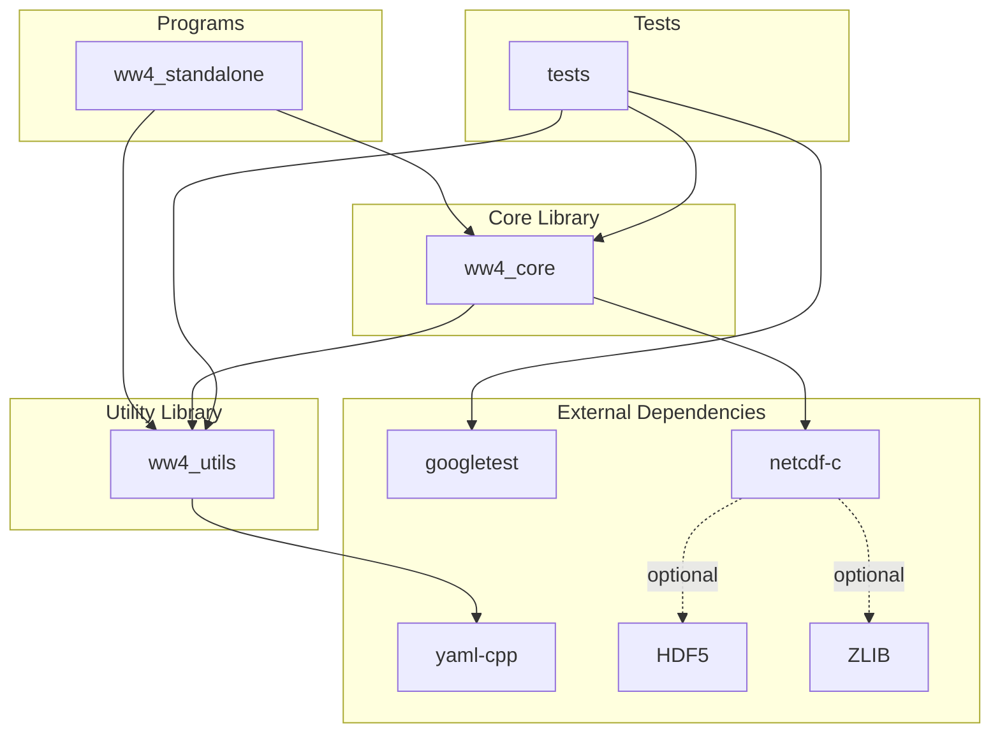
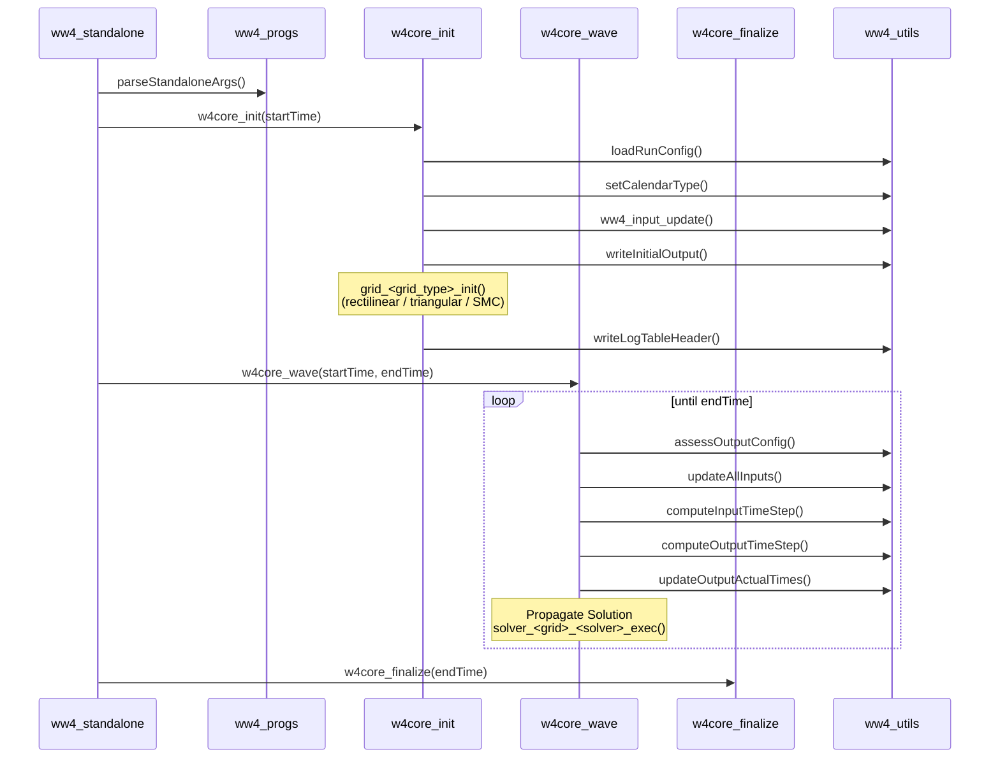
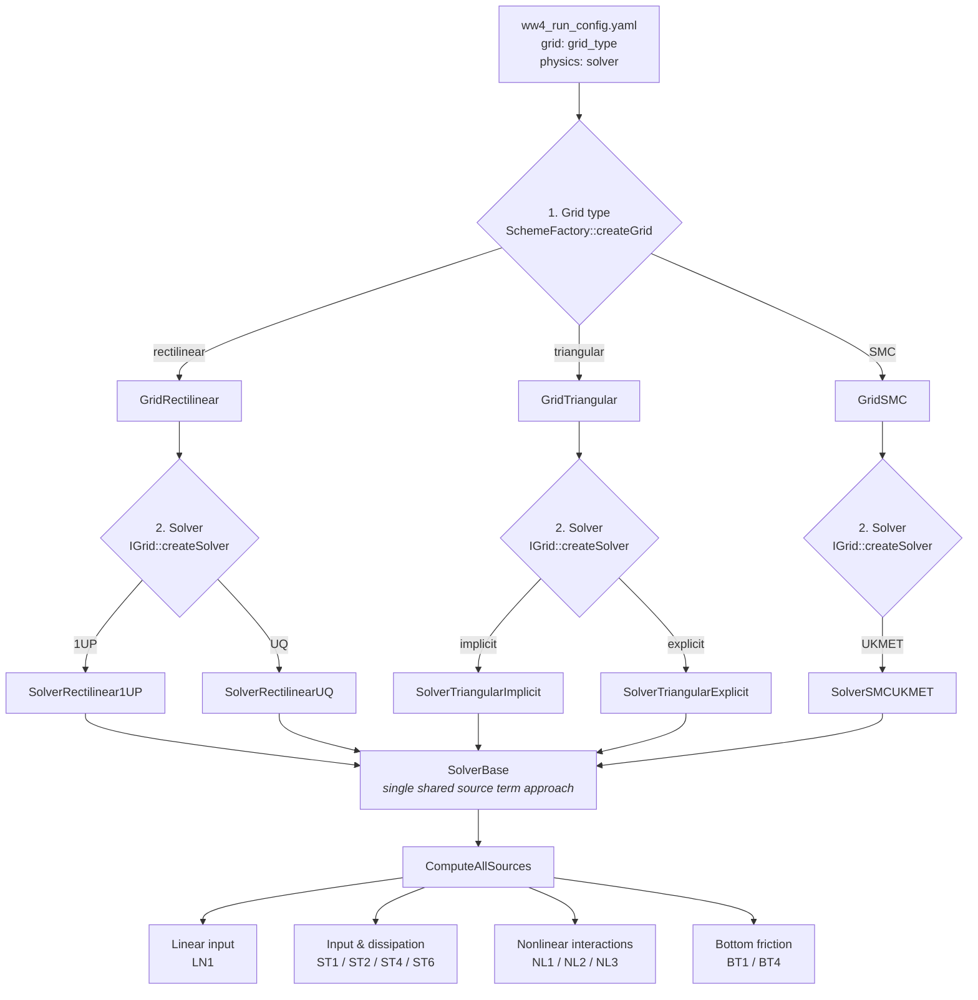
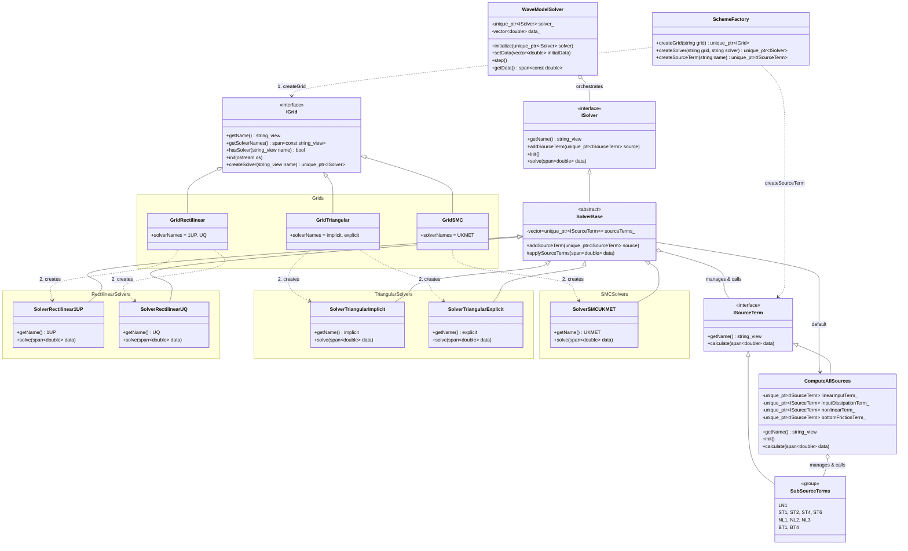
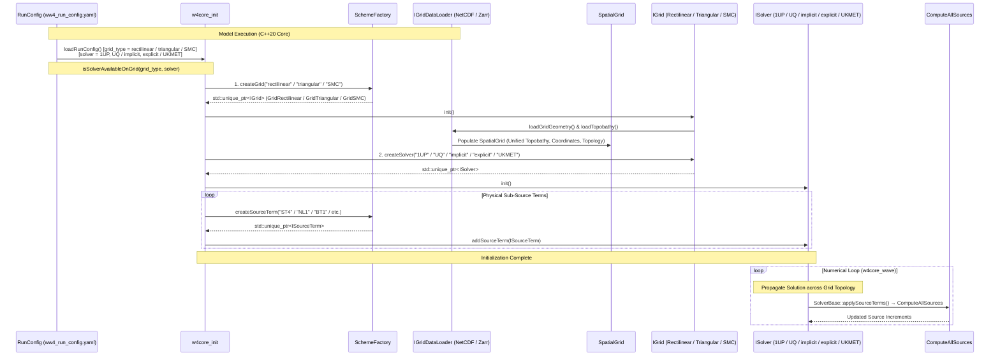

# WAVEWATCH IV Architecture

### Key Components

Model options are selected in two stages: first a **grid type**, then a **numerical solver** that is available on that grid. All solvers on all grids share one source term approach.

1.  **IGrid**: The grid strategy interface (first selection stage). A grid owns grid ingestion and domain decomposition (`init`) and acts as the factory for the solvers available on it (`getSolverNames`, `hasSolver`, `createSolver`).
2.  **Grids (`GridRectilinear`, `GridTriangular`, `GridSMC`)**: Concrete grid types (`grid_type` = `rectilinear`, `triangular`, `SMC`).
3.  **ISolver**: The integration strategy interface (second selection stage). It defines the contract for numerical solvers that combine dynamics (propagation) and physics (source terms) to advance the model state.
4.  **Solvers**: Concrete numerical solvers per grid:
    - Rectilinear grid: `SolverRectilinear1UP` (`1UP`) and `SolverRectilinearUQ` (`UQ`).
    - Triangular grid: `SolverTriangularImplicit` (`implicit`) and `SolverTriangularExplicit` (`explicit`).
    - SMC grid: `SolverSMCUKMET` (`UKMET`).
5.  **SolverBase**: Common base class of all solvers. Holds the single, shared source term approach: registered `ISourceTerm` objects are evaluated in order during `solve`, with `ComputeAllSources` used if none were registered.
6.  **ISourceTerm**: The physical strategy interface for WAVEWATCH IV sub-source terms.
7.  **Source Term Implementations** (unchanged, independent of grid and solver):
    - **ComputeAllSources**: Unified routine called by every solver through `SolverBase`. Manages and executes physical `ISourceTerm` sub-source terms instantiated via `SchemeFactory`.
    - **Linear Input**: `SourceTermLN1` (LN1).
    - **Input and Dissipation**: `SourceTermST1` (ST1), `SourceTermST2` (ST2), `SourceTermST4` (ST4), and `SourceTermST6` (ST6).
    - **Nonlinear Interactions**: `SourceTermNL1` (NL1), `SourceTermNL2` (NL2), and `SourceTermNL3` (NL3).
    - **Bottom Friction**: `SourceTermBT1` (BT1) and `SourceTermBT4` (BT4).
8.  **SchemeFactory**: Instantiates model components: `createGrid(grid)`, `createSolver(grid, solver)` (shorthand for `createGrid(grid)->createSolver(solver)`), and `createSourceTerm(name)`.
9.  **WaveModelSolver**: The high-level orchestrator solver. It manages the simulation loop and triggers the configured solver at each time step.

This document describes the high-level architecture of WAVEWATCH IV (WW4) using a Mermaid diagram.

## Component Diagram



## Call Structure

The following diagram illustrates the sequence of function calls when running the `ww4_standalone` program.



## Description of Components

- **Programs**: Contains end-user applications. `ww4_standalone` is a simplified environment for running the wave model core.
- **Core Library (`ww4_core`)**: Implements the main wave model routines, including initialization (`w4core_init`), time stepping (`w4core_wave`), finalization (`w4core_finalize`), numerical solvers, and physical source terms located under `src/ww4_core/source_terms/`.
- **Utility Library (`ww4_utils`)**: Provides common functionality such as time management, configuration loading, logging, and standard output utilities.
- **Tests**: Contains unit tests (Level 1, prefixed with `L1_test_`) and integration tests (Level 2, prefixed with `L2_test_`) using the Google Test framework.
- **External Dependencies**:
    - `yaml-cpp`: Used for parsing YAML configuration files.
    - `googletest`: Used for unit and integration testing.
    - `netcdf-c`: Used for NetCDF and UGRID dataset reading and writing.
    - `HDF5`: Optional dependency for NetCDF-4 support in `netcdf-c`.
    - `ZLIB`: Optional compression library dependency for NetCDF-4 support in `netcdf-c`.

## Runtime Grid and Solver Selection

WW4 uses an integrated **Strategy** and **Factory** design pattern with a two-stage selection. The user first selects a grid type (`grid -> grid_type` in `ww4_run_config.yaml`), and then a numerical solver that is available on that grid (`physics -> solver`). Invalid combinations (for example `rectilinear` with `implicit`) are rejected when the run-time configuration is loaded. To support complex interleaving of physics and dynamics (e.g., implicit sub-stepping), physical source terms are managed and called directly by the **Solver**, using a single approach shared by all solvers (`SolverBase`).

### Model option selection



| `grid_type`   | Grid class         | `solver`   | Solver class               |
|---------------|--------------------|------------|----------------------------|
| `rectilinear` | `GridRectilinear`  | `1UP`      | `SolverRectilinear1UP`     |
| `rectilinear` | `GridRectilinear`  | `UQ`       | `SolverRectilinearUQ`      |
| `triangular`  | `GridTriangular`   | `implicit` | `SolverTriangularImplicit` |
| `triangular`  | `GridTriangular`   | `explicit` | `SolverTriangularExplicit` |
| `SMC`         | `GridSMC`          | `UKMET`    | `SolverSMCUKMET`           |

### Source layout

```text
src/ww4_core/
├── grid.h                       IGrid interface (grid type + solver factory)
├── solver.h                     ISolver interface
├── solver_base.{h,cpp}          SolverBase (shared source term approach)
├── scheme_factory.{h,cpp}       createGrid / createSolver / createSourceTerm
├── grid_rectilinear/
│   ├── grid_rectilinear.{h,cpp}         GridRectilinear
│   ├── grid_rectilinear_init.{h,cpp}    grid ingestion and domain decomposition
│   ├── solver_rectilinear_1UP.{h,cpp}   SolverRectilinear1UP
│   ├── solver_rectilinear_UQ.{h,cpp}    SolverRectilinearUQ
│   ├── UQ_domains / UQ_domain_topology / UQ_one_domain   domain decomposition
│   └── utils_UQ_IO/                     grid and partition NetCDF I/O
├── grid_triangular/
│   ├── grid_triangular.{h,cpp}             GridTriangular
│   ├── grid_triangular_init.{h,cpp}        grid ingestion (placeholder)
│   ├── solver_triangular_implicit.{h,cpp}  SolverTriangularImplicit
│   └── solver_triangular_explicit.{h,cpp}  SolverTriangularExplicit
├── grid_SMC/
│   ├── grid_SMC.{h,cpp}            GridSMC
│   ├── grid_SMC_init.{h,cpp}       grid ingestion (placeholder)
│   └── solver_SMC_UKMET.{h,cpp}    SolverSMCUKMET
└── source_terms/                   ComputeAllSources and LN1, ST*, NL*, BT*
```

### Class diagram



The source term classes (`SourceTermLN1`, `SourceTermST1`, `SourceTermST2`, `SourceTermST4`, `SourceTermST6`, `SourceTermNL1`, `SourceTermNL2`, `SourceTermNL3`, `SourceTermBT1`, `SourceTermBT4`) each implement `ISourceTerm` (`getName()`, `calculate(span<double>)`) and are grouped as `SubSourceTerms` above for readability. They are not affected by the grid and solver selection.

> **Current state of run-time dispatch:** `w4core_init` and `w4core_wave` dispatch on the `RunConfig` enums (`GridType`, `SolverType`) to `grid_<grid>_init()` and the mock `solver_<grid>_<solver>_exec()` routines. The `SchemeFactory` / `IGrid` / `ISolver` objects implement the same two-stage selection and are used by `WaveModelSolver`; wiring them into `w4core_init` / `w4core_wave` is a follow-up step. The run-time check `ww4_utils::isSolverAvailableOnGrid()` and `IGrid::hasSolver()` are kept consistent by a unit test.

## Integrated Ingestion & Runtime Factory Architecture

The complete runtime architecture—from NetCDF configuration loading, factory instantiation, grid data ingestion, solver initialization, and spectral physics computation—is illustrated below:



## Decoupled Grid Data Abstractions & Coupling Server Ranks

To ensure clean memory boundaries, zero allocation waste, and complete separation between full domain topology and local numerics:

* **Compute ranks hold ONLY `LocalGridPartition` data.** Compute ranks never allocate memory for the `FullGrid` dynamic state array, eliminating memory waste.
* **Internal Partition Map File Export (`writePartitionMapNetCDF`):** If no precomputed partition map file exists at model startup, the internal partitioner (`partitionGlobalGrid`) computes domain assignments and **writes the mapping to file (`partition_map.nc`)** as a side output via `writePartitionMapNetCDF` for subsequent model runs.
* **Dedicated Coupling Server Ranks:** For large operational models and real-time asynchronous coupling (e.g., online AI/ML surrogates, wave-surge-ocean coupling, or data assimilation), one or more MPI ranks are reserved specifically as **Dedicated Coupling Server Ranks**. These server ranks host the `FullGrid` topology and output buffers, receiving local field updates asynchronously via non-blocking MPI calls while compute ranks immediately proceed to the next numerical time step.

```mermaid
graph TD
    FG["FullGrid&nbsp;(Full&nbsp;Domain&nbsp;Metadata)<br/>&#8209;&nbsp;NX_full,&nbsp;NY_full&nbsp;/&nbsp;N_nodes<br/>&#8209;&nbsp;Full&nbsp;Topobathy&nbsp;&&nbsp;Coordinates"]

    subgraph PartMap ["Partitioning Lifecycle"]
        PM_CHK{"partition_map.nc<br/>exists?"}
        PM_READ["Read&nbsp;Precomputed<br/>partition_map.nc"]
        PM_GEN["Generate&nbsp;Internal&nbsp;Partition<br/><i>(grid&nbsp;specific)</i>"]
        PM_WRITE["Export partition_map.nc<br/><i>(writePartitionMapNetCDF)</i>"]

        PM_CHK -- Yes --> PM_READ
        PM_CHK -- No --> PM_GEN
        PM_GEN -. Export File .-> PM_WRITE
    end

    FG --> PM_CHK

    subgraph ComputeRanks ["Compute Ranks (Rank 0 ... Rank C&#8209;1)"]
        LP0["LocalGridPartition&nbsp;(Rank&nbsp;0)<br/><i>&#8209;&nbsp;nx_local,&nbsp;ny_local&nbsp;+&nbsp;halo</i><br/><i>&#8209;&nbsp;Local&nbsp;Topobathy&nbsp;(std::span)</i><br/><i>&#8209;&nbsp;local_to_global_map</i>"]
        LPC["LocalGridPartition&nbsp;(Rank&nbsp;C&#8209;1)<br/><i>&#8209;&nbsp;nx_local,&nbsp;ny_local&nbsp;+&nbsp;halo</i><br/><i>&#8209;&nbsp;Local&nbsp;Topobathy&nbsp;(std::span)</i><br/><i>&#8209;&nbsp;local_to_global_map</i>"]

        S0["ISolver (Rank 0)"]
        SC["ISolver&nbsp;(Rank&nbsp;C&#8209;1)"]

        LP0 --> S0
        LPC --> SC
    end

    subgraph IORanks ["Dedicated IO and coupling ranks (Rank C ... Rank C+I&#8209;1)"]
        IOR["IO&nbsp;and&nbsp;coupling&nbsp;ranks<br/><i>&#8209;&nbsp;Holds&nbsp;FullGrid&nbsp;Output&nbsp;Buffers</i><br/><i>&#8209;&nbsp;Asynchronous&nbsp;Zarr&nbsp;/&nbsp;NetCDF&nbsp;Disk&nbsp;Writes</i>"]
    end

    PM_READ --> LP0
    PM_READ --> LPC
    PM_GEN --> LP0
    PM_GEN --> LPC

    S0 -. Asynchronous Field Data .-> IOR
    SC -. Asynchronous Field Data .-> IOR
```



1. **`FullGrid` (Full Model Domain Metadata):**
   * Contains full domain dimensions ($NX_{\text{full}}, NY_{\text{full}}$ or $N_{\text{nodes}}$), coordinate vectors, and full topobathy.
   * **Memory Allocation:** Resides **strictly on Dedicated Coupling Server Ranks** (or transiently on Rank 0 during startup partition generation). **Compute ranks NEVER allocate or save `FullGrid` state arrays.**
2. **`LocalGridPartition` (Sub-Domain Compute Grid):**
   * Encapsulates the local rank's sub-mesh ($nx_{\text{local}}, ny_{\text{local}}$ or $n_{\text{local}}$), including surrounding halo/ghost cells required for stencil flux calculations across sub-domain boundaries.
   * Contains local coordinate vectors, local topobathy contiguous buffers, halo exchange communication tables, and `local_to_global_map`.
   * **Solver Independence:** `ISolver` implementations (`SolverRectilinear1UP`, `SolverRectilinearUQ`, `SolverTriangularImplicit`, `SolverTriangularExplicit`, `SolverSMCUKMET`) and physical source terms (`ComputeAllSources`) operate *strictly* on `LocalGridPartition` views (`std::span<const double>`). Numerical solvers are completely agnostic to whether execution is single-process or multi-node MPI!