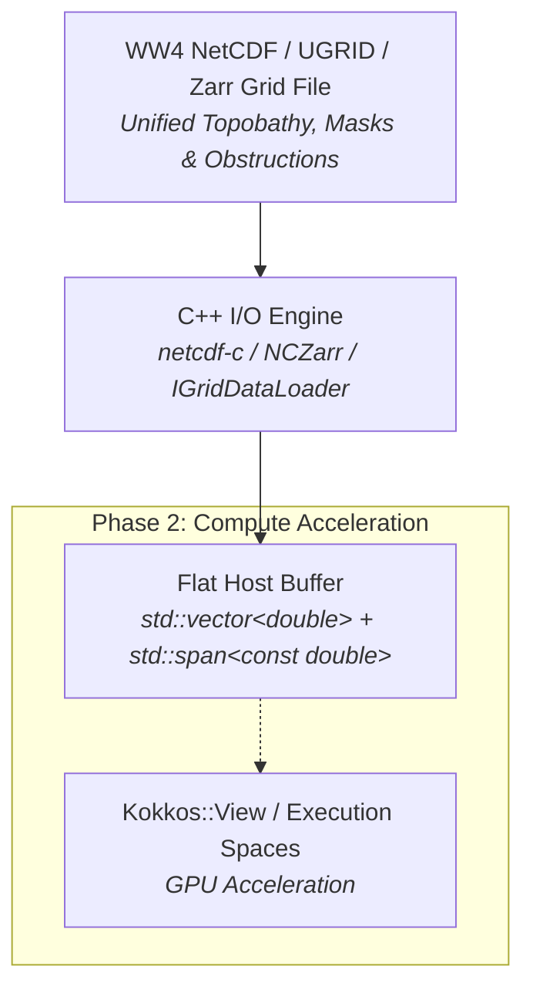
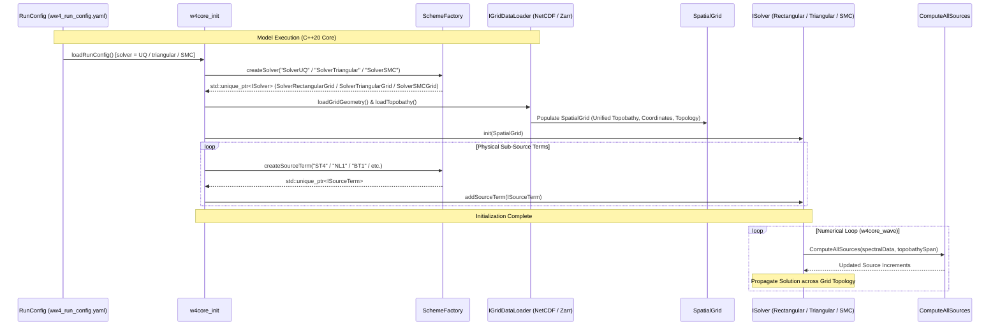
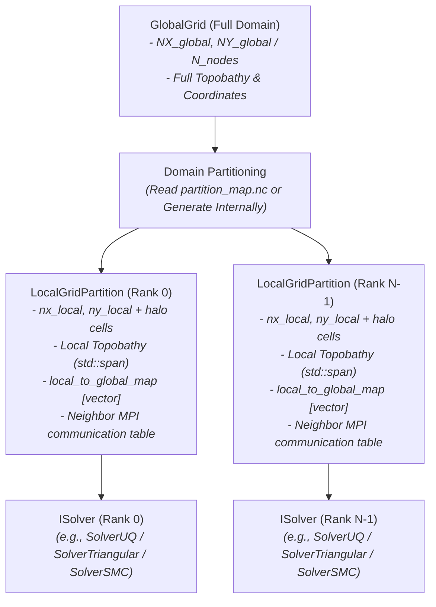

# Architectural Assessment: Ingestion of NetCDF, UGRID, and Zarr Spatial Grids & Topobathy (Bathymetry / Orography) in WAVEWATCH IV (WW4)

## 1. Executive Summary
This assessment presents a strategic roadmap for bringing spatial grid definitions, unstructured meshes (UGRID), cloud-native Zarr datasets, unified topobathy (bathymetry/orography elevation) fields, and domain decomposition topologies into WAVEWATCH IV (WW4). The proposal evaluates language runtime choices, existing library ecosystems across NOAA-EMC and the HPC ocean/atmospheric community, performance portability via Kokkos, single-domain full-grid abstraction layer designs, and integration with the **Runtime Scheme Selection Architecture** (PR #72, now merged into `develop`) leveraging the Factory Pattern (`SchemeFactory`) and Strategy Pattern (`ISolver`). The assessment assumes that spatial grid definitions, topobathy elevation fields, land/sea masks, and sub-grid obstruction fields are provided in standardized NetCDF/UGRID/Zarr input files (e.g., generated externally by tools such as `gridgen`), while evaluating memory layouts and I/O pipelines for future MPI domain decomposition, parallel chunked Zarr output streaming, and distributed restart checkpointing.

---

## 2. Language Choice (Full C++ Core with Python Tooling Ecosystem)

### Recommendation: **Full C++ Core with Python Tooling Ecosystem**
* **Core Model (In-Model Grid & Elevation Ingestion): Pure C++20**
  * **Zero Overhead & Operational HPC Readiness:** In high-performance operational environments (e.g., Cray/HPC clusters at NOAA NCEP like Cactus/Dogwood), running Python inside the core numerical iteration loop or during model startup introduces GIL lock risks, non-standard runtime dependencies, and potential multi-threading/MPI interaction issues.
  * **Memory Safety & Control:** Reading large spatial elevation arrays (bathymetry/orography) and connectivity meshes directly into C++ data structures via C/C++ APIs ensures zero-copy vectorization, strict RAII memory management, and `std::span` compatibility.
* **Pre-Processing & External Tooling:**
  * Spatial grid generation and pre-processing (such as producing land/water masks, topobathy elevation arrays, and sub-grid obstruction fields) are performed externally prior to model execution.
  * External grid generation tools (e.g., `gridgen`) output standardized NetCDF, UGRID, or Zarr spatial grid files that feed directly into WW4's pure C++ ingestion engine (`IGridDataLoader`).

---

## 3. Library Evaluation & NOAA-EMC Ecosystem Search

### NOAA-EMC & Community Toolset Landscape
A survey of NOAA-EMC, UFS (Unified Forecast System), and NCEPLIBS repositories indicates the following key patterns:
1. **`NCEPLIBS` / ESMF (Earth System Modeling Framework):** NOAA-EMC relies heavily on ESMF and standard C NetCDF libraries (`netcdf-c`) across UFS components (e.g., `UFS-Weather-Model`, `NEMS`). ESMF provides UGRID/mesh mapping for coupled modeling.
2. **NetCDF-C with NCZarr (Standard NetCDF C Library v4.8.0+):**
   * **Zarr V2 Support:** Modern `netcdf-c` includes native support for **NCZarr** (NetCDF4 Zarr backend) for Zarr V2 datasets. This allows C/C++ code calling standard NetCDF APIs to read both traditional NetCDF-4/HDF5 files and cloud-native Zarr V2 datasets (via local files, HTTP S3 endpoints, or zip archives) through the same C/C++ API.
   * **Zarr V3 Compatibility Limitations:** Not all C libraries automatically support Zarr V3. The Zarr V3 specification introduces structural changes—including unified `zarr.json` metadata nodes, updated codec pipelines (e.g., sharding), and new node representations that replace legacy `.zarray`/`.zattrs` JSON files. Standard `netcdf-c` NCZarr and traditional C I/O libraries do not automatically handle Zarr V3 stores without dedicated driver updates or conversion layers.
3. **UGRID Conventions (Unstructured Grid Interchange Format):**
   * Standardized CF-convention extensions for unstructured grids (triangular, polygon, SMC grids).
   * Defines topology variables (`mesh_topology`, `face_node_connectivity`, `edge_node_connectivity`, `node_coordinates`).

### Recommended C++ Library Stack & Zarr Strategy for WW4:
* **Primary C++ I/O Engine:** `netcdf-c` / `netcdf-cxx4` (or a modern C++20 RAII wrapper around `netcdf-c`).
  * Enables reading NetCDF3, NetCDF4, and Zarr V2 (via NCZarr).
  * Highly optimized and ubiquitous on HPC modules (`module load netcdf`).
  * Avoids introducing heavy non-standard C++ Zarr dependencies into core operational HPC builds.
* **Zarr V3 Ingestion Strategy:**
  * **Operational HPC / Pipeline Approach (Recommended):** Use Python pre-processing tools (`tools/`) leveraging `xarray` and `zarr` v3 to convert Zarr V3 datasets into NetCDF-4 or Zarr V2 before model execution.
  * **Optional Direct C++ Reader:** For direct Zarr V3 reading without pre-processing, isolate Zarr V3 support behind the `IGridDataLoader` interface (e.g., using specialized libraries like Google TensorStore or modern C++ Zarr V3 adapters) behind an optional CMake build flag (`WW4_ENABLE_ZARR_V3=OFF`), preserving a minimal core build footprint.
* **Mesh Topology Abstraction:** Modern C++ structs in `ww4_utils` that parse CF/UGRID metadata attributes (`cf_role = "mesh_topology"`, `node_coordinates`, `face_node_connectivity`).

---

## 4. Performance Portability & Kokkos Evaluation

### Recommendation: **Not Yet for Grid I/O, but Design Data Layouts for Future Kokkos Integration**

* **Is this the time to introduce Kokkos?**
  * **No (for I/O & Grid Parsing):** File I/O and grid parsing are strictly host-side setup routines. Kokkos is designed for compute kernel performance portability (GPUs/CPUs). Introducing Kokkos during grid reading would add significant template complexity, heavy build dependencies, and compiler setup overhead without benefiting I/O.
  * **Yes (for Data Abstraction Design):** While Kokkos should not be linked now, the **memory layout** of spatial grids, elevation fields, and field data must be architected with flat, contiguous allocation patterns (1D/2D contiguity, 64-byte alignment, strided index accessors via `std::span` or `std::mdspan` / C++20/C++23 abstractions).

* **Strategic Transition Path:**



---

## 5. Integration with Runtime Scheme Selection Design & Factory Pattern

The grid ingestion framework integrates directly with the runtime scheme selection architecture (PR #72, merged into `develop`). This design leverages the **Factory Pattern** (`SchemeFactory`) to instantiate numerical solvers and physical source terms based on runtime user configuration options in `ww4_run_config.yaml`. Lowercase aliases for solvers and source terms have been removed in PR #170 to enforce exact string identifiers throughout configuration parsing and component creation.

### 5.1 User Configuration Options (`RunConfig`)
User options are loaded from `ww4_run_config.yaml` into the `RunConfig` structure during model initialization (`w4core_init`). The mandatory `physics.solver` option determines the numerical propagation scheme and corresponding spatial grid type:

```yaml
physics:
  solver: "UQ"          # Mandatory solver choice: 'UQ', 'triangular', or 'SMC'
  linear_input: "none"  # 'none', 'LN1'
  input_dissipation: "ST4" # 'none', 'ST1', 'ST2', 'ST4', 'ST6'
  nonlinear_interactions: "NL1" # 'none', 'NL1', 'NL2', 'NL3'
  bottom_friction: "BT1"  # 'none', 'BT1', 'BT4'

grid:
  type: "netcdf"        # Data format: 'netcdf', 'ugrid', 'zarr_v2', 'zarr_v3'
  file_path: "grids/global_mesh.nc"
  mesh_name: "ww4_mesh"
  variables:
    longitude: "lon"
    latitude: "lat"
    topobathy: "elevation" # Unified single field for bathymetry & orography
    land_mask: "mask"
```

### 5.2 Factory Pattern (`SchemeFactory`) & Concrete Solvers
`SchemeFactory::createSolver(solver_name)` validates user input and returns a `std::unique_ptr<ISolver>` polymorphically bound to the appropriate grid-specific solver implementation:

* **Exact Scheme String Key Mapping:**
  * In `RunConfig` (`ww4_run_config.yaml`), `physics.solver` accepts exact keys `'UQ'`, `'triangular'`, or `'SMC'`.
  * `SchemeFactory::createSolver` accepts exact capitalized string identifiers:
    * `"SolverUQ"` $\rightarrow$ Instantiates **`SolverRectangularGrid`**
    * `"SolverTriangular"` $\rightarrow$ Instantiates **`SolverTriangularGrid`**
    * `"SolverSMC"` $\rightarrow$ Instantiates **`SolverSMCGrid`**
  * All lowercase aliases have been removed for strict, deterministic runtime component lookup.

### 5.3 The Three Concrete Spatial Grids
The three concrete grid solvers derive from `ISolver` and encapsulate distinct grid topologies, coordinate systems, and spatial discretization schemes:

1. **Rectangular Grid (`SolverRectangularGrid` / `"SolverUQ"`):**
   * **Topology:** Structured 2D rectilinear spatial grid defined by uniform or non-uniform latitude ($\Delta y$) and longitude ($\Delta x$) increments.
   * **Data Access:** Direct 2D array indexing $(i, j)$ backed by flat contiguous 1D memory buffers (`std::vector<double>`) and C++20 `std::span` views.
   * **Numerical Scheme:** Used for structured propagation schemes like **UQ** (Ultimate Quickest 3rd-order advection scheme).

2. **Triangular Unstructured Grid (`SolverTriangularGrid` / `"SolverTriangular"`):**
   * **Topology:** Unstructured triangular mesh conforming to UGRID conventions (`cf_role = "mesh_topology"`).
   * **Data Access:** Node coordinate vectors (`node_x`, `node_y`), element topology connectivity (`face_node_connectivity`), and edge-based flux vectors.
   * **Numerical Scheme:** Enables flexible, high-resolution coastal refinement using implicit or explicit finite-element/finite-volume triangular unstructured solvers.

3. **Spherical Multiple-Cell Grid (`SolverSMCGrid` / `"SolverSMC"`):**
   * **Topology:** Hierarchical multi-resolution SMC grid structure that eliminates polar singularity constraints by doubling cell size towards the poles.
   * **Data Access:** Flat arrays of active cell descriptors (cell positions, refinement levels, area factors) and directional mapping arrays ($i, j$ face linkages).
   * **Numerical Scheme:** Optimized for efficient global wave modeling with multi-resolution cell refinement along coastlines and ice edges.

### 5.4 Unified Topobathy Elevation Representation
In alignment with WW4 architectural directives:
* **Single Elevation Grid Array:** Bathymetry (water depth) and orography (subaerial terrain elevation) are represented together as a **single unified topobathy elevation grid array** (`elevation` / `topobathy`), rather than as two separate arrays.
* **Datum Convention:** Positive elevation values denote water depth (bathymetry), while negative values (or explicit datum offsets) represent subaerial terrain and orography.
* **Storage & Views:** `SpatialGrid` stores the unified topobathy array in flat, 64-byte aligned contiguous host buffers, providing non-owning C++20 `std::span<const double>` views directly to `ISolver` implementations without copy overhead.

### 5.5 Source Term Integration Strategy Pattern (`ISourceTerm` & `ComputeAllSources`)
`ISolver` instances orchestrate the integration of physical source terms during numerical propagation sub-stepping:
1. `SchemeFactory::createSourceTerm` creates `ISourceTerm` concrete instances for configured physical sub-source terms using exact capitalized identifiers (`"ComputeAllSources"`, `"LN1"`, `"ST1"`, `"ST2"`, `"ST4"`, `"ST6"`, `"NL1"`, `"NL2"`, `"NL3"`, `"BT1"`, `"BT4"`).
2. `ISolver::addSourceTerm(std::unique_ptr<ISourceTerm>)` attaches sub-source terms to the solver instance.
3. During numerical time-stepping (`w4core_wave`), concrete solvers execute physical source terms through the centralized **`ComputeAllSources`** engine, ensuring separation between spatial grid dynamics and spectral physics.

---

## 6. Integrated Ingestion & Runtime Factory Architecture

The complete runtime architecture—from NetCDF configuration loading, factory instantiation, grid data ingestion, solver initialization, and spectral physics computation—is illustrated below:



---

## 8. Role of Zarr: Static Grid Ingestion vs. High-Volume Output & Restart Files

### 8.1 Static Grid Data Ingestion (NetCDF/UGRID Sufficiency)
* **Data Volume & Access Pattern:**
  * Spatial grid definitions (latitude/longitude coordinates, node topologies, unified topobathy elevation, land/sea masks, and sub-grid obstruction fields) are **static, read-once inputs** loaded during model initialization (`w4core_init`).
  * For typical global meshes (e.g., $0.25^\circ$ or $0.1^\circ$), static grid data sizes range from a few megabytes to tens of megabytes.
* **Assessment:**
  * **Zarr is NOT required or advantageous for static grid reading.** Standard NetCDF-4 (`netcdf-c`) and UGRID NetCDF files provide robust, fast, and ubiquitous I/O at model startup on HPC systems. Introducing Zarr for static grid ingestion adds unnecessary dependency overhead without noticeable I/O performance gains.

### 8.2 Full Gridded Output & Restart Files (Key Zarr Use Cases)
* **Data Volume & Dimensionality:**
  * Wave model dynamic fields (spectral state density $A(f, \theta, x, y, t)$, mean wave parameters, swell components, and directional spectra) represent 4D/5D tensors ($T \times X \times Y \times F \times \theta$). Output volume reaches tens of gigabytes to terabytes per run.
  * Restart files require complete high-precision dumps of the full spectral energy distribution across every active spatial grid cell.
* **Advantages of Zarr/NCZarr for Output & Restarts:**
  * **Parallel Chunk-Aligned Writes:** In a multi-node MPI execution, Zarr's chunked layout enables each MPI domain to write its local sub-mesh directly to its designated spatial chunk without forcing all ranks to gather data to Rank 0 or block on monolithic file locks.
  * **Cloud-Native Storage Readiness:** Allows operational pipelines and cloud HPC deployments (e.g., AWS S3, Google Cloud Storage, Blob Storage) to stream output fields directly to cloud object stores for real-time visualization and post-processing without intermediate POSIX filesystem staging.
  * **Distributed Restart Checkpointing:** Each MPI process can independently stream or read its assigned restart tensor chunk directly using structured Zarr keys, dramatically reducing initialization and checkpointing time for operational restart loops.

---

## 9. Domain Decomposition Architecture: Full vs. Partitioned Grid Data for MPI Setup

As WW4 evolves toward MPI domain decomposition (e.g., Cardigan/METIS grid partitioning or rectilinear 2D decomposition), input grid files will describe the **Full Global Grid** ($G_{\text{full}}$), whereas individual MPI ranks will execute compute operations on **Local Partition Grids** ($G_{\text{local}}$) augmented with ghost/halo boundary cells.

### 9.1 Decoupled Grid Data Abstractions (`GlobalGrid` vs. `LocalGridPartition`)
To ensure clean memory boundaries, zero allocation waste, and complete separation between global topology and local numerics, the grid architecture cleanly separates global and local grid data:



1. **`GlobalGrid` (Full Domain Metadata):**
   * Contains global grid dimensions ($NX_{\text{global}}, NY_{\text{global}}$ or $N_{\text{nodes}}$), global coordinate arrays, and global topobathy.
   * **Memory Lifecycle:** Exists in memory **only on Rank 0** or designated I/O manager nodes (or transiently discarded on compute ranks after local sub-domain slices are extracted during startup).
2. **`LocalGridPartition` (Sub-Domain Compute Grid):**
   * Encapsulates the local rank's sub-mesh ($nx_{\text{local}}, ny_{\text{local}}$ or $n_{\text{local}}$), including surrounding halo/ghost cells required for finite-difference/finite-element flux stencils across sub-domain boundaries.
   * Contains local coordinate vectors, local topobathy contiguous buffers, halo exchange communication tables (neighbor MPI rank IDs, boundary cell indices), and the mapping vector `local_to_global_map`.
   * **Solver Independence:** `ISolver` implementations (`SolverRectangularGrid`, `SolverTriangularGrid`, `SolverSMCGrid`) and physical source terms (`ComputeAllSources`) receive and operate *strictly* on `LocalGridPartition` views (`std::span<const double>`). Numerical solvers are completely agnostic to whether the execution is single-process or multi-node MPI!

### 9.2 Flexible Partition Map Lifecycle (`PartitionManager` & File Workflow)
The domain decomposition engine supports flexible runtime configuration via `ww4_run_config.yaml` (`grid.partition.mode`):

* **Mode A: Read Precomputed Partition File (`read_file`):**
  * Reads domain partitioning directly from an external partition map file (e.g., `partition_map.nc` produced by external partitioners or previous WW4 runs) via `PartitionIO::readPartitionMapNetCDF`.
  * Each rank reads its assigned partition ID, local cell indices, and halo topology, bypassing internal partitioning compute.
* **Mode B: Internal Partition Generation & Export (`generate_internal` / `auto`):**
  * If no partition map file exists (or when explicitly requested), Rank 0 / startup initializer invokes the internal domain partitioner (`partitionGlobalGrid`, e.g. Cardigan/METIS/rectilinear band partitioning).
  * Immediately after partition generation, the mapping is written to file (`partition_map.nc`) via `PartitionIO::writePartitionMapNetCDF` for subsequent model runs.
  * Worker ranks receive their domain assignments, allocate local memory, and proceed with model execution.

### 9.3 Clean Memory Management & Full Gridded Output Reconstruction

#### Recommended Architectural Preference: **Option A (Direct Chunked Parallel I/O via Zarr / NCZarr / Parallel NetCDF-4)**

Between the two output reconstruction strategies for multi-rank operational deployments, **Option A is strongly preferred and recommended as the primary architectural choice** for WW4 high-performance scaling.

* **Primary Recommendation: Option A — Direct Chunked Parallel I/O (Zarr / NCZarr / Parallel NetCDF-4)**
  * **How it works:** Each MPI process writes its local dynamic state vector ($A_{\text{local}}$) directly into its assigned spatial hyperslab or chunk in the target Zarr or parallel NetCDF dataset using its `local_to_global_map`.
  * **Why it is preferred:**
    1. **Strict $O(1)$ Rank-0 Memory Footprint:** Rank 0 memory footprint remains constant regardless of total global mesh resolution. On fine global grids (e.g., $0.1^\circ$ or sub-kilometer coastal meshes), gathering full-grid 4D/5D spectral state tensors onto Rank 0 requires tens of gigabytes of RAM on a single node, causing out-of-memory (OOM) crashes.
    2. **Elimination of Rank 0 I/O Bottlenecks:** Compute ranks write their chunked slices in parallel directly to storage without blocking worker ranks during time-stepping.
    3. **Native Cloud & Operational Alignment:** Directly outputs structured cloud-native Zarr stores ready for real-time operational streaming without needing post-processing aggregation passes.

* **Optional Fallback: Option B — Distributed Gathering to I/O Manager (Gather-to-Rank-0 / I/O Server)**
  * **How it works:** During output intervals, compute ranks send local field slices to designated I/O ranks or Rank 0 via non-blocking `MPI_Gatherv` using `local_to_global_map`. Rank 0 assembles $G_{\text{full}}$ in temporary buffer memory and writes monolithic NetCDF-4 files.
  * **Role:** Retained strictly as an optional fallback layer for lightweight single-node execution, debugging runs, or legacy environments where parallel chunked writing is unavailable.

---

## 10. Summary & Next Steps Roadmap

1. **Step 1:** Define C++ `SpatialGrid`, `GlobalGrid`, and `LocalGridPartition` memory layouts and `IGridDataLoader` interface specification in `src/ww4_utils/` for NetCDF, UGRID, and Zarr grid input files.
2. **Step 2:** Integrate `netcdf-c` dependency into `CMakeLists.txt` (behind CMake flags, e.g. `WW4_ENABLE_NETCDF=ON`).
3. **Step 3:** Implement `SpatialGrid` and `IGridDataLoader` structs in `src/ww4_utils/` with C++20 `std::span` memory accessors for unified topobathy elevation and coordinate topology.
4. **Step 4:** Maintain integration with `SchemeFactory::createSolver` in `src/ww4_core/` (merged in PR #72) to bind grid ingestion data directly to instantiated `SolverRectangularGrid`, `SolverTriangularGrid`, and `SolverSMCGrid` solver implementations based on `RunConfig` options (`physics.solver`).
5. **Step 5:** Implement NetCDF / UGRID / NCZarr data loaders capable of reading NetCDF grid files and populating `SpatialGrid` for rectangular, triangular mesh, and SMC grid structures.
6. **Step 6:** Implement `PartitionManager` and `PartitionIO` for reading precomputed NetCDF partition map files or generating and exporting partition maps internally (`partition_map.nc`).
7. **Step 7:** Implement Python conversion tooling (`tools/`) and optional C++ adapter for Zarr V3 dataset support.
8. **Step 8:** Add unit tests under `tests/ww4_utils/` and `tests/ww4_core/` using synthesized NetCDF/NCZarr grid test files and partition map datasets.
