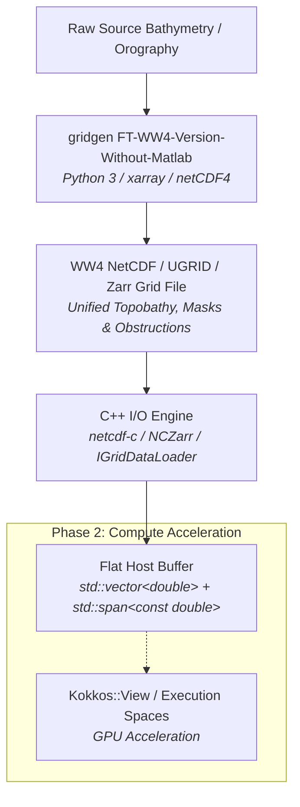
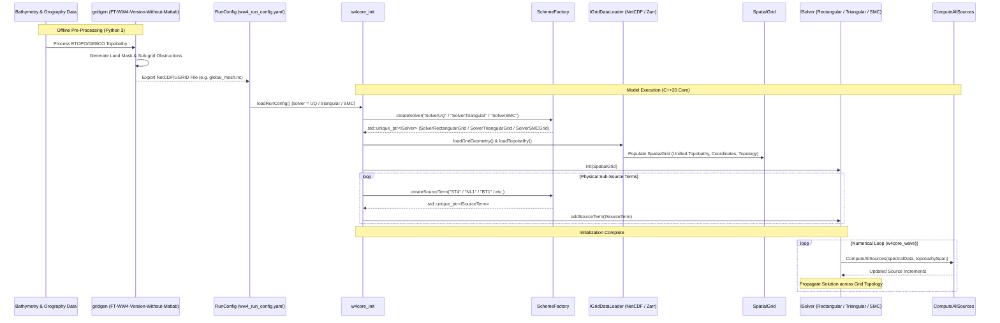

# Architectural Assessment: Ingestion of NetCDF, UGRID, and Zarr Spatial Grids & Topobathy (Bathymetry / Orography) in WAVEWATCH IV (WW4)

## 1. Executive Summary
This assessment presents a strategic roadmap for bringing spatial grid definitions, unstructured meshes (UGRID), cloud-native Zarr datasets, and unified topobathy (bathymetry/orography elevation) fields into WAVEWATCH IV (WW4). The proposal evaluates language runtime choices, existing library ecosystems across NOAA-EMC and the HPC ocean/atmospheric community, performance portability via Kokkos, single-domain full-grid abstraction layer designs, and integration with the **Runtime Scheme Selection Architecture** (PR #72, now merged into `develop`) leveraging the Factory Pattern (`SchemeFactory`) and Strategy Pattern (`ISolver`). Crucially, this assessment incorporates the pre-processing grid generation capabilities of **`gridgen` for WW4** from the `FT-WW4-Version-Without-Matlab` branch (`HendrikTolman-NOAA/gridgen`), which replaces legacy MATLAB grid generation with a pure Python 3 / NetCDF workflow.

---

## 2. Language Choice (Full C++ Core with Python Tooling Ecosystem)

### Recommendation: **Full C++ Core with Python Tooling Ecosystem**
* **Core Model (In-Model Grid & Elevation Ingestion): Pure C++20**
  * **Zero Overhead & Operational HPC Readiness:** In high-performance operational environments (e.g., Cray/HPC clusters at NOAA NCEP like Cactus/Dogwood), running Python inside the core numerical iteration loop or during model startup introduces GIL lock risks, non-standard runtime dependencies, and potential multi-threading/MPI interaction issues.
  * **Memory Safety & Control:** Reading large spatial elevation arrays (bathymetry/orography) and connectivity meshes directly into C++ data structures via C/C++ APIs ensures zero-copy vectorization, strict RAII memory management, and `std::span` compatibility.
* **Pre-Processing, Grid Generation, & Analysis: Python Tooling (`gridgen`)**
  * Grid generation and pre-processing are handled out-of-model using `gridgen` (`HendrikTolman-NOAA/gridgen` branch `FT-WW4-Version-Without-Matlab`). By removing legacy MATLAB dependencies, `gridgen` now operates purely in Python 3 using `xarray`, `netCDF4`, `numpy`, `scipy`, `pyproj`, `shapely`, and `matplotlib`.
  * External Python tooling in `gridgen` generates validated NetCDF/UGRID/Zarr spatial grid files, topobathy elevation arrays, land/water masks, and sub-grid obstruction fields, feeding directly into WW4's C++ ingestion engine (`IGridDataLoader`).

---

## 3. Library Evaluation & NOAA-EMC Ecosystem Search

### NOAA-EMC & Community Toolset Landscape
A survey of NOAA-EMC, UFS (Unified Forecast System), and NCEPLIBS repositories indicates the following key patterns:
1. **`NCEPLIBS` / ESMF (Earth System Modeling Framework):** NOAA-EMC relies heavily on ESMF and standard C NetCDF libraries (`netcdf-c`) across UFS components (e.g., `UFS-Weather-Model`, `NEMS`). ESMF provides UGRID/mesh mapping for coupled modeling.
2. **NetCDF-C with NCZarr (Standard NetCDF C Library v4.8.0+):**
   * **Zarr V2 Support:** Modern `netcdf-c` includes native support for **NCZarr** (NetCDF4 Zarr backend) for Zarr V2 datasets. This allows C/C++ code calling standard NetCDF APIs to read both traditional NetCDF-4/HDF5 files and cloud-native Zarr V2 datasets (via local files, HTTP S3 endpoints, or zip archives) through the same C/C++ API.
   * **Zarr V3 Compatibility Limitations:** Not all C libraries automatically support Zarr V3. The Zarr V3 specification introduces structural changes—including unified `zarr.json` metadata nodes, updated codec pipelines (e.g., sharding), and new node representations that replace legacy `.zarray`/`.zattrs` JSON files. Standard `netcdf-c` NCZarr and traditional C I/O libraries do not automatically handle Zarr V3 stores without dedicated driver updates or conversion layers.
3. **UGRID Conventions (Unstructured Grid Interchange Format):**
   * Standardized CF-convention extensions for unstructured grids (triangular, polygon, SMC grids).
   * Defines topology variables (`mesh_topology`, `face_node_connectivity`, `edge_node_connectivity`, `node_coordinates`).

### Recommended C++ Library Stack & Zarr Strategy for WW4:
* **Primary C++ I/O Engine:** `netcdf-c` / `netcdf-cxx4` (or a modern C++20 RAII wrapper around `netcdf-c`).
  * Enables reading NetCDF3, NetCDF4, and Zarr V2 (via NCZarr).
  * Highly optimized and ubiquitous on HPC modules (`module load netcdf`).
  * Avoids introducing heavy non-standard C++ Zarr dependencies into core operational HPC builds.
* **Zarr V3 Ingestion Strategy:**
  * **Operational HPC / Pipeline Approach (Recommended):** Use Python pre-processing tools (`tools/`) leveraging `xarray` and `zarr` v3 to convert Zarr V3 datasets into NetCDF-4 or Zarr V2 before model execution.
  * **Optional Direct C++ Reader:** For direct Zarr V3 reading without pre-processing, isolate Zarr V3 support behind the `IGridDataLoader` interface (e.g., using specialized libraries like Google TensorStore or modern C++ Zarr V3 adapters) behind an optional CMake build flag (`WW4_ENABLE_ZARR_V3=OFF`), preserving a minimal core build footprint.
* **Mesh Topology Abstraction:** Modern C++ structs in `ww4_utils` that parse CF/UGRID metadata attributes (`cf_role = "mesh_topology"`, `node_coordinates`, `face_node_connectivity`).

---

### 3.1 `gridgen` Setup & Architecture (`FT-WW4-Version-Without-Matlab`)

#### Background & Objectives
`gridgen` is the official NOAA grid generation framework for WAVEWATCH. Historically, `gridgen` relied on proprietary MATLAB scripts to ingest global high-resolution bathymetry datasets (e.g., ETOPO, GEBCO), create regular/curvilinear/unstructured spatial masks, calculate sub-grid obstructions (cell-side and cell-area transparency factors for sub-grid land/ice features), and export grid definition files.

The **`FT-WW4-Version-Without-Matlab`** branch (`https://github.com/HendrikTolman-NOAA/gridgen/tree/FT-WW4-Version-Without-Matlab`) modernizes `gridgen` for WW4 by completely removing the MATLAB runtime dependency. It re-architects all grid generation, masking, topobathy processing, and obstruction calculation algorithms in pure **Python 3**, leveraging the open-source scientific Python stack and outputting modern NetCDF/UGRID files directly consumable by WW4.

#### Key Features & Improvements in `gridgen` for WW4
1. **Complete Removal of MATLAB:** Replaces MATLAB routines with Python 3 modules (`numpy`, `scipy`, `xarray`, `netCDF4`, `pyproj`, `shapely`).
2. **Unified Topobathy Processing:** Combines ocean bathymetry and subaerial orography into a single contiguous grid array with user-defined datums and shoreline boundaries.
3. **Automated Land-Sea Masking:** Generates land, water, boundary, and active/inactive cell masks for rectangular, curvilinear, triangular UGRID, and Spherical Multiple-Cell (SMC) grids.
4. **Sub-Grid Obstruction Calculation:** Computes directional cell-side transmission coefficients ($SX$, $SY$) and cell-area blockage factors ($SX0$, $SY0$) to represent unresolved islands, reefs, and narrow channels.
5. **Direct NetCDF4 / UGRID Export:** Outputs standard CF-compliant NetCDF4 files containing spatial coordinates, topobathy elevation arrays, land masks, and sub-grid obstruction fields that match WW4's C++ `IGridDataLoader` requirements.
6. **Container & CI/CD Readiness:** Operates seamlessly within Docker/Apptainer containers and automated GitHub Actions CI/CD pipelines without commercial software licenses.

#### Environment Setup & Installation Workflow

To set up `gridgen` for WW4 from the `FT-WW4-Version-Without-Matlab` branch:

```bash
# 1. Clone the gridgen repository and switch to the FT-WW4-Version-Without-Matlab branch
git clone https://github.com/HendrikTolman-NOAA/gridgen.git
cd gridgen
git checkout FT-WW4-Version-Without-Matlab

# 2. Create and activate a Python 3 virtual environment
python3 -m venv venv
source venv/bin/activate

# 3. Upgrade pip and install core dependencies
pip install --upgrade pip
pip install numpy scipy xarray netCDF4 pyproj shapely matplotlib pyyaml

# 4. (Optional) Install gridgen in editable mode
pip install -e .
```

Alternatively, using `conda` / `mamba`:

```bash
conda create -n gridgen_ww4 python=3.11 numpy scipy xarray netcdf4 pyproj shapely matplotlib pyyaml -c conda-forge
conda activate gridgen_ww4
```

#### Execution Workflow & Output Artifacts

`gridgen` is executed via command-line interface (CLI) scripts or Python configuration functions:

```bash
# Run grid generation using a WW4 YAML specification file
python -m gridgen.create_grid --config ww4_grid_config.yaml --output build/global_5m.nc
```

`gridgen` produces standard NetCDF4 files containing:
* **Spatial Coordinates:** `longitude` / `latitude` 1D or 2D coordinate arrays (or `node_x` / `node_y` for UGRID triangular meshes).
* **Unified Topobathy:** `topobathy` / `elevation` (2D or 1D node array in meters, positive depth / negative terrain).
* **Land-Sea Mask:** `mask` (0 = land/excl, 1 = active water, 2 = boundary/forced).
* **Sub-Grid Obstructions:** `obstruction_x`, `obstruction_y` (transparency factors $[0, 1]$ for wave flux across cell boundaries).

---

## 4. Performance Portability & Kokkos Evaluation

### Recommendation: **Not Yet for Grid I/O, but Design Data Layouts for Future Kokkos Integration**

* **Is this the time to introduce Kokkos?**
  * **No (for I/O & Grid Parsing):** File I/O and grid parsing are strictly host-side setup routines. Kokkos is designed for compute kernel performance portability (GPUs/CPUs). Introducing Kokkos during grid reading would add significant template complexity, heavy build dependencies, and compiler setup overhead without benefiting I/O.
  * **Yes (for Data Abstraction Design):** While Kokkos should not be linked now, the **memory layout** of spatial grids, elevation fields, and field data must be architected with flat, contiguous allocation patterns (1D/2D contiguity, 64-byte alignment, strided index accessors via `std::span` or `std::mdspan` / C++20/C++23 abstractions).

* **Strategic Transition Path:**



---

## 5. Integration with Runtime Scheme Selection Design & Factory Pattern

The grid ingestion framework integrates directly with the runtime scheme selection architecture (PR #72, merged into `develop`). This design leverages the **Factory Pattern** (`SchemeFactory`) to instantiate numerical solvers and physical source terms based on runtime user configuration options in `ww4_run_config.yaml`. Lowercase aliases for solvers and source terms have been removed in PR #170 to enforce exact string identifiers throughout configuration parsing and component creation.

### 5.1 User Configuration Options (`RunConfig`)
User options are loaded from `ww4_run_config.yaml` into the `RunConfig` structure during model initialization (`w4core_init`). The mandatory `physics.solver` option determines the numerical propagation scheme and corresponding spatial grid type:

```yaml
physics:
  solver: "UQ"          # Mandatory solver choice: 'UQ', 'triangular', or 'SMC'
  linear_input: "none"  # 'none', 'LN1'
  input_dissipation: "ST4" # 'none', 'ST1', 'ST2', 'ST4', 'ST6'
  nonlinear_interactions: "NL1" # 'none', 'NL1', 'NL2', 'NL3'
  bottom_friction: "BT1"  # 'none', 'BT1', 'BT4'

grid:
  type: "netcdf"        # Data format: 'netcdf', 'ugrid', 'zarr_v2', 'zarr_v3'
  file_path: "grids/global_mesh.nc"
  mesh_name: "ww4_mesh"
  variables:
    longitude: "lon"
    latitude: "lat"
    topobathy: "elevation" # Unified single field for bathymetry & orography
    land_mask: "mask"
```

### 5.2 Factory Pattern (`SchemeFactory`) & Concrete Solvers
`SchemeFactory::createSolver(solver_name)` validates user input and returns a `std::unique_ptr<ISolver>` polymorphically bound to the appropriate grid-specific solver implementation:

* **Exact Scheme String Key Mapping:**
  * In `RunConfig` (`ww4_run_config.yaml`), `physics.solver` accepts exact keys `'UQ'`, `'triangular'`, or `'SMC'`.
  * `SchemeFactory::createSolver` accepts exact capitalized string identifiers:
    * `"SolverUQ"` $\rightarrow$ Instantiates **`SolverRectangularGrid`**
    * `"SolverTriangular"` $\rightarrow$ Instantiates **`SolverTriangularGrid`**
    * `"SolverSMC"` $\rightarrow$ Instantiates **`SolverSMCGrid`**
  * All lowercase aliases have been removed for strict, deterministic runtime component lookup.

### 5.3 The Three Concrete Spatial Grids
The three concrete grid solvers derive from `ISolver` and encapsulate distinct grid topologies, coordinate systems, and spatial discretization schemes:

1. **Rectangular Grid (`SolverRectangularGrid` / `"SolverUQ"`):**
   * **Topology:** Structured 2D rectilinear spatial grid defined by uniform or non-uniform latitude ($\Delta y$) and longitude ($\Delta x$) increments.
   * **Data Access:** Direct 2D array indexing $(i, j)$ backed by flat contiguous 1D memory buffers (`std::vector<double>`) and C++20 `std::span` views.
   * **Numerical Scheme:** Used for structured propagation schemes like **UQ** (Ultimate Quickest 3rd-order advection scheme).

2. **Triangular Unstructured Grid (`SolverTriangularGrid` / `"SolverTriangular"`):**
   * **Topology:** Unstructured triangular mesh conforming to UGRID conventions (`cf_role = "mesh_topology"`).
   * **Data Access:** Node coordinate vectors (`node_x`, `node_y`), element topology connectivity (`face_node_connectivity`), and edge-based flux vectors.
   * **Numerical Scheme:** Enables flexible, high-resolution coastal refinement using implicit or explicit finite-element/finite-volume triangular unstructured solvers.

3. **Spherical Multiple-Cell Grid (`SolverSMCGrid` / `"SolverSMC"`):**
   * **Topology:** Hierarchical multi-resolution SMC grid structure that eliminates polar singularity constraints by doubling cell size towards the poles.
   * **Data Access:** Flat arrays of active cell descriptors (cell positions, refinement levels, area factors) and directional mapping arrays ($i, j$ face linkages).
   * **Numerical Scheme:** Optimized for efficient global wave modeling with multi-resolution cell refinement along coastlines and ice edges.

### 5.4 Unified Topobathy Elevation Representation
In alignment with WW4 architectural directives:
* **Single Elevation Grid Array:** Bathymetry (water depth) and orography (subaerial terrain elevation) are represented together as a **single unified topobathy elevation grid array** (`elevation` / `topobathy`), rather than as two separate arrays.
* **Datum Convention:** Positive elevation values denote water depth (bathymetry), while negative values (or explicit datum offsets) represent subaerial terrain and orography.
* **Storage & Views:** `SpatialGrid` stores the unified topobathy array in flat, 64-byte aligned contiguous host buffers, providing non-owning C++20 `std::span<const double>` views directly to `ISolver` implementations without copy overhead.

### 5.5 Source Term Integration Strategy Pattern (`ISourceTerm` & `ComputeAllSources`)
`ISolver` instances orchestrate the integration of physical source terms during numerical propagation sub-stepping:
1. `SchemeFactory::createSourceTerm` creates `ISourceTerm` concrete instances for configured physical sub-source terms using exact capitalized identifiers (`"ComputeAllSources"`, `"LN1"`, `"ST1"`, `"ST2"`, `"ST4"`, `"ST6"`, `"NL1"`, `"NL2"`, `"NL3"`, `"BT1"`, `"BT4"`).
2. `ISolver::addSourceTerm(std::unique_ptr<ISourceTerm>)` attaches sub-source terms to the solver instance.
3. During numerical time-stepping (`w4core_wave`), concrete solvers execute physical source terms through the centralized **`ComputeAllSources`** engine, ensuring separation between spatial grid dynamics and spectral physics.

---

## 6. Integrated Ingestion & Runtime Factory Architecture

The complete runtime architecture—from offline grid generation with `gridgen` to configuration loading, factory instantiation, grid data ingestion, solver initialization, and spectral physics computation—is illustrated below:



---

## 7. Summary & Next Steps Roadmap

1. **Step 1:** Establish `gridgen` environment setup (`FT-WW4-Version-Without-Matlab`) and Python workflow integration in `tools/gridgen/` for automated WW4 spatial grid generation.
2. **Step 2:** Integrate `netcdf-c` dependency into `CMakeLists.txt` (behind CMake flags, e.g. `WW4_ENABLE_NETCDF=ON`).
3. **Step 3:** Implement `SpatialGrid` and `IGridDataLoader` structs in `src/ww4_utils/` with C++20 `std::span` memory accessors for unified topobathy elevation and coordinate topology.
4. **Step 4:** Maintain integration with `SchemeFactory::createSolver` in `src/ww4_core/` (merged in PR #72) to bind grid ingestion data directly to instantiated `SolverRectangularGrid`, `SolverTriangularGrid`, and `SolverSMCGrid` solver implementations based on `RunConfig` options (`physics.solver`).
5. **Step 5:** Implement NetCDF / UGRID / NCZarr data loaders capable of reading `gridgen`-produced NetCDF grid files and populating `SpatialGrid` for rectangular, triangular mesh, and SMC grid structures.
6. **Step 6:** Implement Python conversion tooling (`tools/`) and optional C++ adapter for Zarr V3 dataset support.
7. **Step 7:** Add unit tests under `tests/ww4_utils/` and `tests/ww4_core/` using synthesized NetCDF/NCZarr grid test files generated via `gridgen`.
